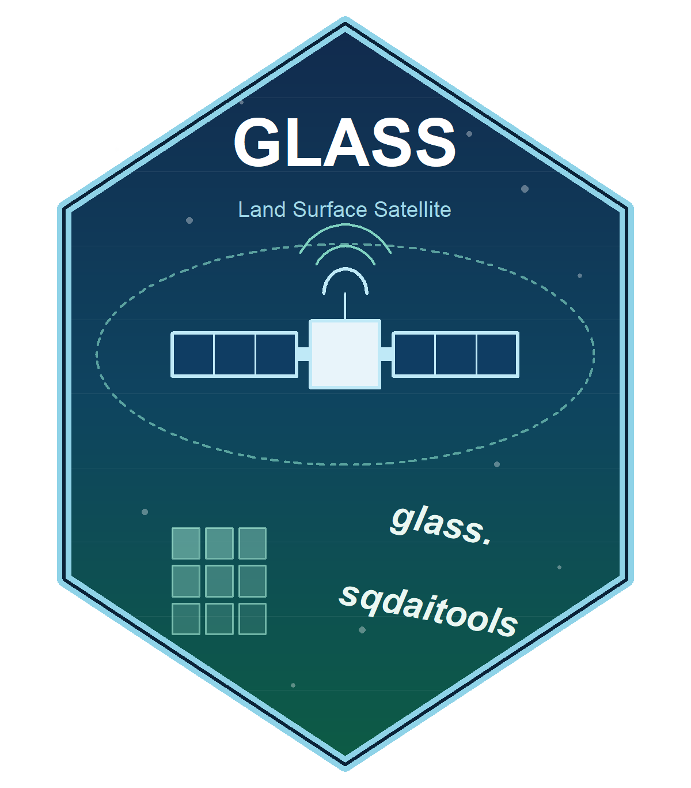

<!-- README.md is generated from README.Rmd. Please edit that file -->

```{r, include = FALSE}
knitr::opts_chunk$set(
  collapse = TRUE,
  comment = "#>",
  fig.path = "man/figures/README-",
  eval = FALSE
)
```

# glass.sqdaitools 

<!-- badges: start -->
[](https://github.com/GISerDaiShaoqing/glass.sqdaitools/actions/workflows/R-CMD-check.yaml)
<!-- badges: end -->

**glass.sqdaitools** is a toolkit for the whole GLASS data lifecycle: query
products from the [GLASS archive](https://glass.hku.hk/archive/), map your
region of interest onto the `h<h>v<v>` sinusoidal tiling, expand a date range
into composite DOY folders, batch-download with resume + size verification,
and post-process granules with terra (fill values, scaling, reprojection,
multi-tile mosaics, temporal composites).

> **中文简介**:glass.sqdaitools 是 GLASS(Global Land Surface Satellite)数据
> 全流程工具包:查询产品登记表、把研究区映射到正弦投影 h/v 瓦片、日期区间转
> 合成 DOY 文件夹、支持断点续传与大小校验的批量下载,以及基于 terra 的后处理
> (填充值、比例因子、重投影、多瓦片镶嵌、时间合成)。中文快速上手:
> [《快速上手(中文)》](https://gisersqdai.top/glass.sqdaitools/articles/glass-quickstart-zh.html)。

## Installation

```r
# install.packages("devtools")
devtools::install_github("GISerDaiShaoqing/glass.sqdaitools")
```

## Quick start

```{r attach}
library(glass.sqdaitools)
```

### 1. Which tiles does my study area need?

```{r tiles}
tiles <- glass_tiles_for_bbox(120.8, 30.6, 122.2, 31.9)  # Greater Shanghai
tiles
```

`h`/`v` are the sinusoidal tile indices used directly in GLASS file names
(e.g. `h28v05`). For a polygon/multipolygon study area use
`glass_tiles_for_sf(roi)`.

### 2. What products and variants exist?

```{r registry}
glass_registry("LAI", verified_only = TRUE)
```

The registry bundles the archive's directory structure for 133 variants
(product × source × resolution), covering four archive layouts (year/DOY
folders, year-level files, daily YYYYDDD folders and static file
collections). 131 of them are verified against real granules — including
file-naming fragments, composite cadence and band metadata (fill value,
scale factor, valid range) used in the post-processing step.

### 3. Which composite folders cover my date range?

```{r doys}
glass_doys("LAI_MODIS_250M", from = "2018-08-01", to = "2018-12-31")
```

`mode = "span"` keeps every composite overlapping the range (default);
`mode = "start"` keeps only composites that start inside it — the semantics
of the typical legacy scripting workflow.

### 4. One-shot fetch (list + download)

```{r fetch}
files <- glass_fetch(
  "LAI_MODIS_250M",
  from = "2018-08-01", to = "2018-12-31",
  tiles = "h28v05",
  out_dir = "data/glass/lai"
)
```

Downloads are retried, size-checked against the server, and can resume from
a partial `.part`; a `glass_manifest.csv` ledger is written into `out_dir`.
Set `dry_run = TRUE` to preview the manifest first.

### 5. Post-process to your region

```{r process}
mean_lai <- glass_process(
  files,
  roi = roi_sf,        # your study area (sf); its CRS is the target CRS
  product = "LAI_MODIS_250M",
  fun = "mean",        # temporal mean over all composite layers
  outfile = "glass_lai_mean.tif"
)
```

`glass_process()` fills raw values (255 → `NA`, scaled correctly), groups
granules by composite date, mosaics tiles per date, reprojects, crops/masks
to `roi`, and can collapse layers with a function — the whole pipeline of a
typical GLASS post-processing script, parameterised.

### 6. Interactive download UI

```r
glass_app()
```

Draw your ROI on a Leaflet map (toggle roam/draw with one button, click twice
to frame a rectangle), pick a verified variant and dates, preview the
manifest, then download in one click — with an in-page directory browser for
the output folder (no native dialog, works inside RStudio's Viewer pane) and
a per-file progress bar. Requires `shiny` and `leaflet`; the directory
browser additionally uses `shinyFiles`.

## GUI front end: D3L Tool

Prefer a desktop application? [D3L Tool](https://github.com/GISerDaiShaoqing/D3LTool)
([online docs](https://gisersqdai.top/D3LTool/)) is a NASA satellite download
manager. Its **v2.7.0** release integrates GLASS batch downloading built on the
skeleton of this package, while granule post-processing (fill values, mosaics,
reprojection, temporal composites) keeps running on `glass.sqdaitools`. The two
projects are designed as a matched pair: **D3L Tool** for interactive search &
download, **glass.sqdaitools** for reproducible, scriptable processing.

## Acknowledgements

Data are publicly hosted by the GLASS product team
([glass.hku.hk](https://glass.hku.hk)). Please respect their citation
policies; the package only reads public directory listings.

## Author

Shaoqing Dai · [ORCID 0000-0003-0858-4728](https://orcid.org/0000-0003-0858-4728) ·
[Homepage](https://gisersqdai.top/mycv/) ·
[GitHub](https://github.com/GISerDaiShaoqing)
